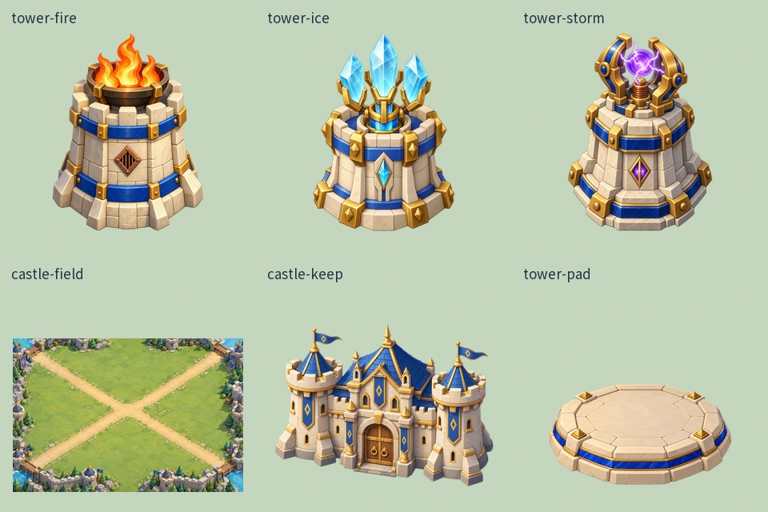
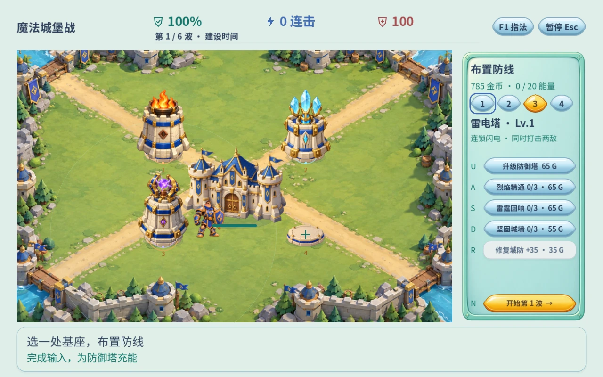
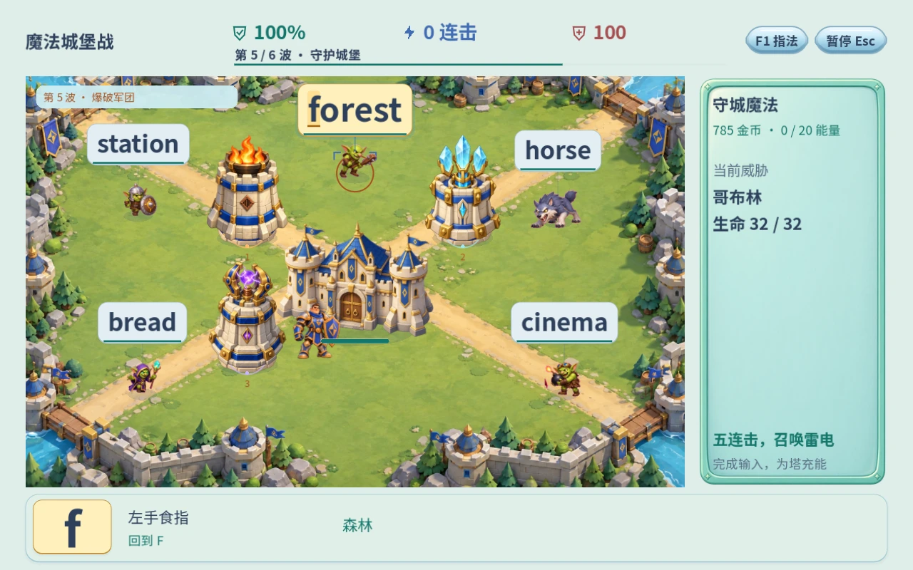
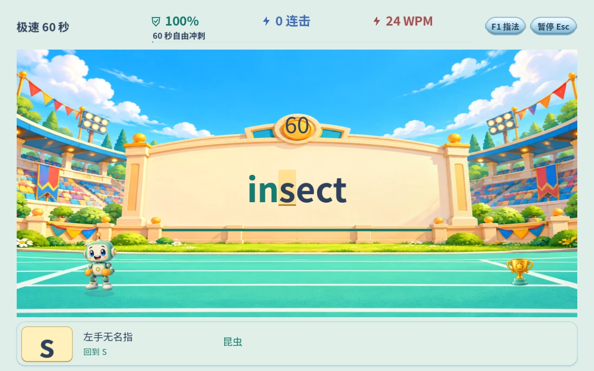
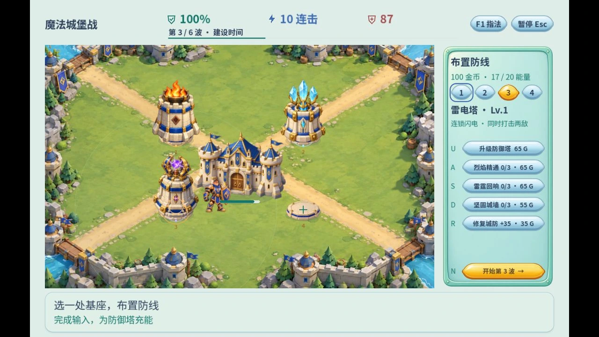
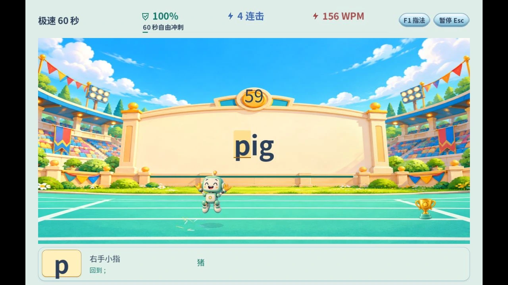

# 1.7 美术素材与场景呈现精修

2026-10-20。使用 `game-developer`、内置 `image_gen` 与 `create-game-assets`。本轮检查十种玩法及菜单的实际渲染，把最明显的素材接缝、尺寸、接地和遮挡问题落实到运行时。

## 美术判断与范围

沿用项目的原创美式商业卡通方向：大体块、圆润倒角、受控细节、统一左上主光、清楚剪影、可读的功能轮廓。皇家世界保留象牙石、蓝色釉面与暖金属；界面继续服从用户指定的明亮、轻松方向。设计文档的色值是提案参考，没有把文档中的“厚重”要求覆盖到用户后续的轻量界面偏好上。

| 玩法 | 审查结论与本轮处理 |
| --- | --- |
| 星桥快跑 | 原生机器人与浮岛已属同一方向；保留动作身份，改善背景／图标缩小时的采样 |
| 泡泡啵啵乐 | 512格透明泡泡与海底适配；保留，使用 mipmaps 控制小尺寸边缘闪烁 |
| 流星拦截队 | 彗星与发射器轮廓清楚；保留已有贴图与动作逻辑，本轮未新画该世界角色 |
| 极速60秒 | 原场景自带实体记分牌，后加的大面板遮住了它；移除遮挡，将倒计时和词排进场内看板，放大机器人并让有效输入驱动前进、停下与庆祝 |
| 气球蹦蹦节 | 现有气球材质与节庆场景一致；保留，改善缩图过滤和入口底影 |
| 星际闪电战 | UFO原生动作、舰船与场景可共同使用；保留俯冲预兆，改善缩图过滤 |
| 地鼠敲敲乐 | 角色和洞口边缘已能融合；保留真实动作，改善小尺寸采样 |
| 赛道拉力赛 | 既有原生行驶／加速动作保留，未用静态新图替代；入口图标取消白圆底，改为较轻的接地阴影 |
| 连击小拳王 | 保留同一对拳手的原生姿态、接触与回弹；未更换人物以免动画身份漂移 |
| 魔法城堡战 | 优先重绘三塔、底座、主堡，并拆分背景；修正前后遮挡、词牌避让、塔头发射点和法术材质 |

旧城堡图集存在相邻素材残片，例如Boss静态裁区左边缘带到其他内容。实机敌人继续使用既有Grok动作；本轮新主堡、三塔与底座全部为独立透明贴图，不再从旧图集裁这些建筑。旧图集仍承担既有法术与兼容回退，不声称所有历史源图都已重制。

## 实际新增素材

内置 Image Gen 生成／编辑6项交付，透明底座增加一次针对背景的修整。最终原图逐个复制进项目，保留生成结果本身的alpha；普通图像工具只做裁切、留边、尺寸归一与缩放，没有绘制新的视觉内容。

| 资产 | 运行时路径 | 像素尺寸 |
| --- | --- | --- |
| tower-fire | `assets/generated/v17/tower-fire.png` | 512×640 |
| tower-ice | `assets/generated/v17/tower-ice.png` | 512×640 |
| tower-storm | `assets/generated/v17/tower-storm.png` | 512×640 |
| castle-field | `assets/generated/v17/castle-field.png` | 1536×1024 |
| castle-keep | `assets/generated/v17/castle-keep.png` | 640×512 |
| tower-pad | `assets/generated/v17/tower-pad.png` | 512×256 |

原图在 `docs/art-sources-v17/`；完整提示词、生成／编辑方式、输入引用、hash、锚点与验收状态在 [来源记录](ART_ASSETS_V17.provenance.json)。使用内置工具模式，没有调用付费API CLI或要求API Key。源图的原始尺寸以记录为准；本轮没有把低分辨率素材放大后称为4K。

## 从图片到游戏

- 主堡从背景中独立出来，受击时有短促形变；三塔共用规范化脚点，建筑不再整座持续呼吸。
- 主堡、基座、守卫与敌人按脚点深度排序；词牌避让更大的建筑区域并最后绘制。清除横贯战场的常驻重复提示，重要波次信息改为短暂的小横幅。
- 真实火球、寒冰和雷电贴图进入施法呈现；火球从主堡或实际塔头发出，火／冰投射演出约140ms到达，游戏输入与伤害结算继续即时处理。
- 极速训练取消810×595的覆盖面板。大字出现在画好的场内记分牌，机器人从原146尺寸增至220尺寸；有效字符推动其沿跑道前进，错误不造距离，暂停冻结，减少动态立即更新进度。
- 新贴图导入采用线性mipmap过滤；入口插画与图标也使用相应缩小过滤，静态图标改用轻底影。资源在入场加载，焦点可预热城堡道具；绘制时不解码图片。
- 原始生成稿留在docs并用`.gdignore`隔离，网页导出剔除不再引用的旧背景、旧世界图与静态教练稿，保留回滚用源文件。

## 验证与性能边界

17组Godot无显示套件共29816检查，0失败。新增美术套件43项检查透明边缘、留边、贴图密度、mipmap配置、实际按键前进、错误／暂停、预热资源收取、建塔扣费、独立贴图、发射点及输入计数。原生OpenGL同套件43项通过；全页原生检查4696项、104页面／分辨率状态通过。26页原生复核截图在本目录配套图片中。Cloudflare两个Python打包测试通过。

本机AMD Radeon 890M、Compatibility/OpenGL、1280×800窗口，每场景预热120帧，再采样150帧；城堡使用7敌人、3塔，持续加入重击粒子。逐帧节奏是约60Hz，表中为实测短样本；没有把约17ms的P95写成全部低于16ms，也没有推广为移动端或所有浏览器的性能承诺。Godot引擎process监控与窗口调度没有分离CPU/GPU，不能把它当纯脚本或纯GPU耗时。完整前后原始数据见 [更新前](ui-review-v17/performance-before.json)、[更新后](ui-review-v17/performance-after.json)。

| 玩法 | 平均FPS | 帧间隔P95 ms | 纹理MiB 前→后 |
| --- | --- | --- | --- |
| dojo | 59.97 | 17.537 | 141.0 → 135.0 |
| bubbles | 59.99 | 17.389 | 36.4 → 30.4 |
| rain | 60.00 | 17.636 | 36.5 → 30.5 |
| sprint | 59.99 | 17.656 | 145.1 → 141.0 |
| castle | 60.02 | 17.511 | 243.8 → 246.7 |
| balloons | 60.02 | 17.805 | 37.8 → 33.5 |
| aliens | 59.98 | 17.419 | 61.8 → 57.5 |
| moles | 59.97 | 17.466 | 61.8 → 57.5 |
| racing | 59.99 | 17.489 | 64.4 → 60.2 |
| fighter | 60.00 | 17.712 | 133.8 → 129.5 |

多数场景纹理占用下降约4–6MiB，城堡因独立新建筑增加约3MiB；不宣称所有指标都下降。未重生成Grok动画，没有插帧，也没有用新静态角色覆盖已有真实动作。

## 线上实测与发布

正式域名使用独立QA档，通过实际键盘建造火焰塔、寒冰塔、修复城防、完成第二波8个目标，再用战斗所得金币建造雷电塔。第一波在检查画面时有4敌突破，因此先修复；最终第3波建设阶段体力87、金币100、3塔、累计10次完整输入／35个有效字符，控制台无警告或错误。这是实际浏览器操作，并非修改QA探针的状态，也不是完整六波手工通关。

极速训练在线输入duck、ant、goat、lion四词，共15/15有效字符；机器人前进并庆祝，场内倒计时59秒，暂停冻结。截图中的WPM来自自动化按键，不代表人的打字速度。普通存档90XP保留。

发布包`build/cloudflare-release-v17`，PCK `keybound/game-a690b8a70ccc16488e00.pck`，原始94817100字节、gzip94141467字节；相比1.6的88.84MB gzip增加约5.30MB。首次PCK下载约94MB，WASM复用现有hash和R2域名权限。线上入口 https://typing.nanokid.win/ 。本轮属于重点场景美术落地与呈现改进，不宣称已经完成所有世界的新角色整套制作、儿童实测或全设备产品认证。
