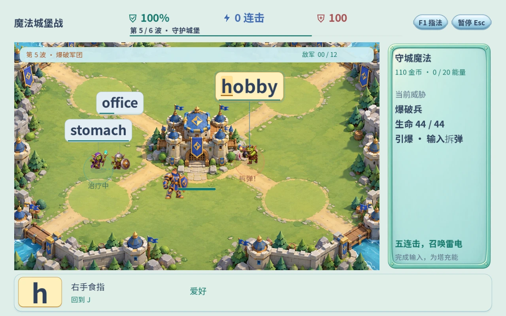
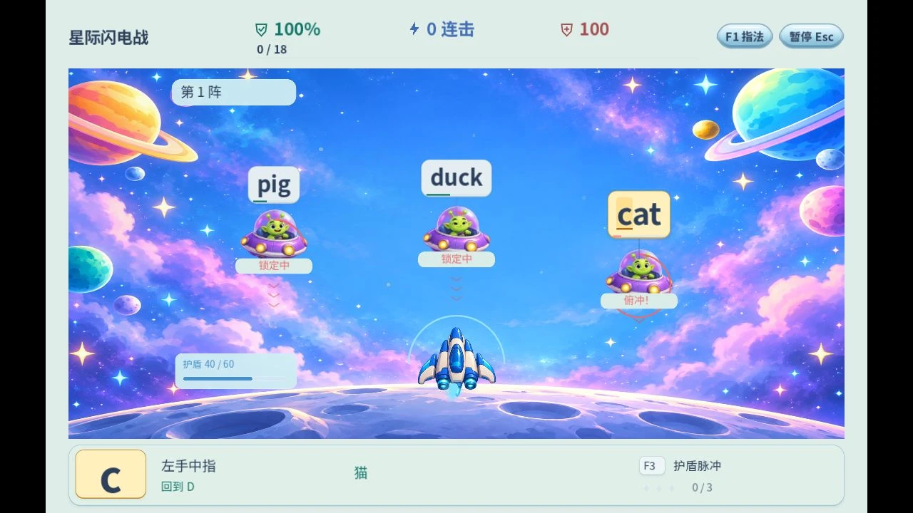
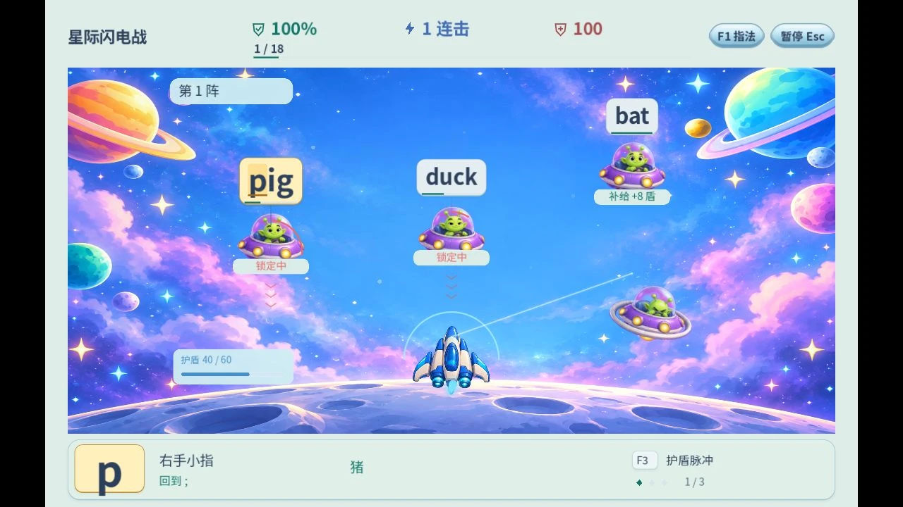

# 1.6 敌人会行动，输入能改变局面

2026-10-20。应用 `game-ai`，在既有动作和反馈之上增加可观察、可打断的决策；本次重点是拳击、外星攻防和城堡战。不是所有十种任务都新增 AI。

## 已实现的玩法

| 场景 | 对手行动 | 玩家应对与实际结果 |
| --- | --- | --- |
| 拳击 | 准备 → 蓄力 → 出拳；蓄力有角色旁的红色叹号与弧线 | 蓄力时完成词可打断，并从普通25伤害提高到50；额外25分 |
| 拳击 | F3准备的格挡吸收下一次反击，随后对手露出破绽 | 下一词在破绽期间命中，同样造成50伤害；没有额外输入键或强制等待 |
| 外星攻防 | 巡航 → 锁定 → 俯冲，红圈与向下箭头预警 | 完整输入击落；在俯冲阶段拦截额外20分。原倒计时总长不缩短，补给舰保留补盾机制 |
| 萨满 | 寻找300像素内生命比例最低的受伤队友，靠近、停下蓄力、治疗 | 完成萨满符文取消治疗，使其恢复2秒；队友死亡、满血或离开施法范围会取消施法，不再瞬间群体回血 |
| 爆破兵 | 接近城堡165像素范围后停下点火，倒数结束仅爆炸一次 | 完成符文拆弹、击退24像素、进入2秒恢复；存活者之后仍可再次尝试点火 |
| 疾行兽 | 先经过左右交替的侧翼航点，再向城堡冲锋 | 改变了接近方向与实际移动轨迹，原有寒冰塔仍能减速 |

训练的施法预兆至少6秒，并随词长增加，再按已选速度缩放；挑战至少4秒，同样按词长和难度缩放。拳击与外星预警沿用既有目标时间，通常占最后40%–60%，不暗中改变词库、提高正确率或增加倒计时速度。长句继续限制场上并发。

## 画面与操作

保留大号完整词牌和底部下一键。预警位于角色旁或脚下；拳击用原横幅显示当前意图，不新增常驻卡片。城堡原有“当前威胁”栏补充该敌人的行动。F1说明破招、格挡、俯冲与拆弹；全部继续可用键盘完成。减少动态仍保留静态警示，避免把必要规则一并隐藏。

使用既有 Grok 原生角色动画，本次没有新生成视频、插帧或替换模型。意图变化由运行时状态与姿态、警示图形表达。

以上为原生 Godot 实际渲染；预警截图使用可重复测试场景，拳击破招通过 `InputEventKey` 输入完成，并非浏览器录制。

## 实现与验证

- `EnemyTactics` 维护明确行动状态与转移，只输出意图、移动目标、速度倍率或待结算动作；`ArcadeRun` / `CastleRun` 处理输入、移动、伤害、奖励；Arena绘制预兆。
- 当前城堡是无障碍开放战场，疾行兽使用预计算侧翼航点；没有加入不需要的每帧寻路，也没有宣称已有复杂地图导航。
- 16组Godot无显示测试共29773检查，0失败；新行为套件56项在30/60/120Hz下检查破招、拦截、真实计分、暂停、施法取消、目标死亡、拆弹、单次爆炸和侧翼转入冲锋。原生OpenGL同套件56项通过，并完成截图。
- 原全页布局检查4696项、104页面/分辨率状态继续通过；Cloudflare两个Python打包测试通过。城堡自动输入模拟30和45 WPM均完成六波、52敌与2个Boss；这是确定性自动测试，不代表儿童试玩或人类实际速度。
- 当前版本没有加入动态调整的隐性难度、在线大模型推理或新存档字段；基础指法练习维持原有宽松规则。

## 发布

Pages + R2 发布包为 `build/cloudflare-release-v16`。PCK `keybound/game-bc6a375e4845a59f37f0.pck`，原始89530060字节，gzip88837611字节；复用原WASM与自定义域名CORS。首次资源下载仍约89MB。

正式域名使用隔离QA存档、真实键盘验证：

- 拳击：`fish` 4/4输入，蓄力状态被打断，体力100、对手体力100→50、破招数1、得分70；含25分奖励。
- 外星：`cat` 3/3输入，俯冲目标被移除，拦截数1、护盾仍40、船体100、得分55；含20分奖励。
- F1在暂停之上显示新增规则，关闭后恢复暂停与原焦点；浏览器控制台无警告/错误。QA档590XP没有写入普通档，普通入口仍为90XP。

以上是正式域名实际浏览器截图。城堡新增施法与拆弹本轮通过模型回归及原生渲染复核；未把这些测试截图称为线上完整六波手工试玩。
