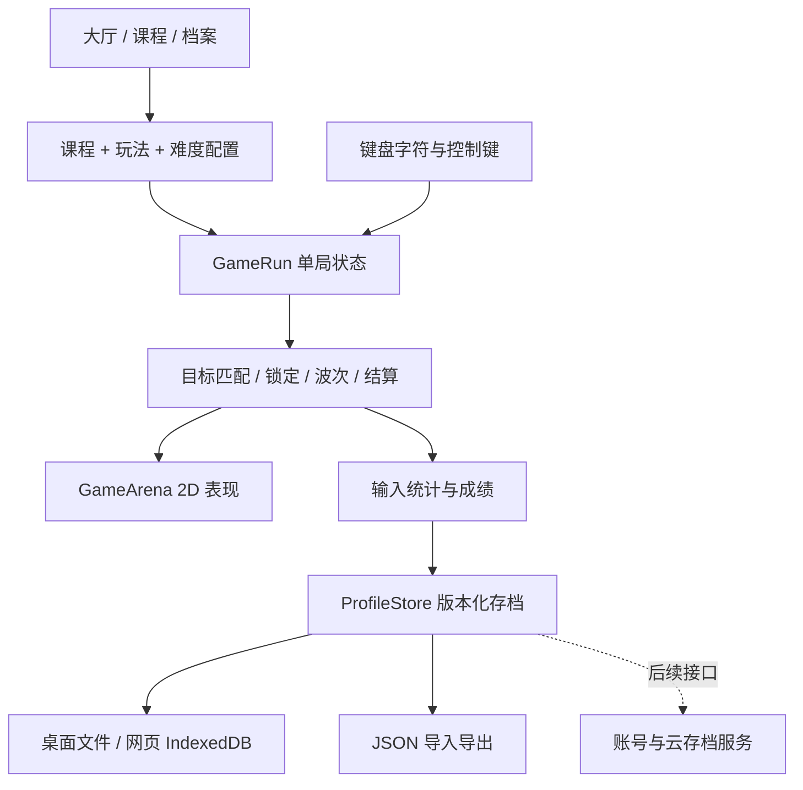

# 键境 Keybound：2D 打字训练游戏总体设计

版本：0.4 · 2026-10-19。本文区分已实现原型与后续产品设计，不能把玩法图鉴理解为全部已经可玩。当前十款可玩；规则与指法教学详见 [玩法说明](ARCADE_AND_FINGERS.md)。0.4 更新全套视觉风格。

## 1. 游戏定位与基本约定

**一句话：从认识 F / J 开始，通过不同类型的 2D 小游戏，成长为能准确、稳定输入完整文本的守护者。**

- 平台：电脑浏览器优先，Windows 桌面用于开发与离线试玩；实体键盘为核心。手机触屏版另做交互，不直接缩小桌面界面。
- 引擎：现有 Godot 4.7.2，GDScript，Compatibility 渲染。网页导出优先关闭线程，减少服务器配置要求。
- 内容：中文界面、英文键盘输入；英语单词是输入素材，不把词汇量当成打字能力。先支持常见 QWERTY，中文拼音输入法训练属于独立后续内容。
- 表现：现代、明亮、活泼的儿童键盘游乐园。奶白与天空蓝背景，白色圆角卡片，靛蓝主按钮；暖黄、珊瑚红、薄荷绿和淡紫用于插画与分区，文字使用深蓝灰。F/J 键帽小伙伴承担欢迎引导，指法键区保留颜色和文字双重提示。各游戏有独立浅色场景，城堡为阳光森林。当前美术由代码绘制。
- 核心原则：准确先于速度；新键先无压力练习，再放入战斗；失败不能抹掉已学进度；没有体力、付费强度和连续登录惩罚。

## 2. 产品结构

主界面是游戏集合，包含打字训练、打字挑战、玩法图鉴、学习档案。城堡防守仅是一种小游戏，不是整个应用的主世界。训练流程为先学手指摆放、选课程再选游戏；挑战大厅提供陨落、冲刺、城堡、气球、外星、地鼠、赛车和格斗，并独立记录成绩。

核心循环：**选择课程 → 指法提示 → 低压热身 → 进入小游戏 → 即时输入反馈 → 结算 → 易错键复习 → 新课程/新挑战**。

每次建议训练 5–10 分钟：1 分钟热身，3–5 分钟主题玩法，1–2 分钟薄弱键复习。连续练习一段时间后温和提示休息，不强制中断正在进行的战斗。

游戏内容由三个互相独立的维度组合：

| 维度 | 例子 | 设计意义 |
|---|---|---|
| 训练内容 | F/J、基准行、全字母、单词、句子、符号 | 决定可以出现什么目标 |
| 游戏机制 | 泡泡、射击、塔防、跑酷、经营 | 决定输入如何改变游戏世界 |
| 难度规则 | 舒缓、标准、挑战、自定义 | 决定移动速度、同时目标数、限时和容错 |

新增一套单词包不需要重写小游戏；新增小游戏也不应复制课程、统计和存档代码。

## 3. 课程与学习目标

| 阶段 | 训练内容 | 推荐先玩 | 学习目标与进阶条件（设计值，需真实试玩校准） |
|---|---|---|---|
| 0 认识键盘 | 坐姿、左右手、F/J 凸点、回位 | 星火练习场 | 不计时；能按提示找到定位键 |
| 1 双食指 | f、j，随后 d、k | 字母泡泡、指法花园 | 单次 18–30 次输入，准确率 ≥90% |
| 2 基准行 | asdf jkl;，再加入 g/h | 双手鼓点、拼字积木 | 形成左右手分工，开始减少键盘提示 |
| 3 上下排 | 上排 → 下排 → 26 字母 | 气球猎手、云端攀登 | 稳定回位，消除个别键位盲区 |
| 4 短词 | 2–4 字母、高频字母组合 | 字母陨落、魔药工坊 | 以准确率为主，不因词汇不熟惩罚 |
| 5 长词 | 4–8 字母，重复字母与组合 | 城堡防守、森林游侠 | 连续输入时减少停顿，建议 20–35 WPM |
| 6 数字与 Shift | 数字行、大小写、常见符号 | 邮局物语、修理小铺 | 区分字符与物理按键；练习双手 Shift |
| 7 文本 | 空格、标点、完整短句 | 打字餐厅、校对侦探 | 不跳空格，不省标点，准确率建议 ≥95% |
| 8 高阶 | 长文、代码片段、多目标、Boss | 代码工匠、无尽围城 | 持续稳定输入，自选 40/60/80 WPM 挑战 |

0.2 实际提供 10 节可选课程，见 `data/curriculum.json`。所有课程开放，便于不同基础的玩家直接选择；训练通关、准确率 ≥90% 且有效输入 ≥18 字符时标记掌握；挑战不标记课程掌握。正式版提供推荐解锁路线，但允许跳级测评和自由练习。

课程不能仅按平均 WPM 解锁。应同时检查样本量、关键键覆盖、准确率和最近多局稳定性。正式版建议连续 3 次短练习达到目标后推荐下一课；失败时提供“降低节奏”和“只练易错键”。

## 4. 小游戏目录（原规划 36 种 + 新增冲刺）

状态：**已实现**表示有可玩原型；其余为规则设计。P0 为当前样板，P1 为第二批优先开发，P2 为内容扩展，P3 为较高复杂度。

| # | 玩法 / 视角 | 输入如何驱动游戏 | 胜负与变化 | 训练目标 | 优先级/状态 |
|---|---|---|---|---|---|
| 01 | 星火练习场 / 固定视角 | 按高亮字母点亮符文，长词逐字完成 | 完成 18 个目标；无倒计时和生命损失 | 零基础找键、回位、准确输入 | P0 已实现 |
| 02 | 字母泡泡 / 单屏 | 输入泡泡字母或词组将其点亮 | 四个可选目标，无时间压力，完成 18 个 | 单键识别、左右手交替 | P0 已实现 |
| 03 | 指法花园 / 俯视 | 每个手指管理一片花田，正确键位浇水 | 完成花圃，不枯萎惩罚；错键显示手指提示 | 手指分工、薄弱键补练 | P1 |
| 04 | 节奏列车 / 横版 | 在宽松节拍窗输入站牌符文给列车动力 | 抵达终点；节拍可关闭，先练均匀输入 | 速度稳定性、减少长停顿 | P2 |
| 05 | 双手鼓点 / 双轨 | 左右手字符沿各自轨道出现 | 练习连续交替；错键保留节拍但扣准确率 | 左右手协调 | P1 |
| 06 | 拼字积木 / 单屏 | 输入下一个字母把积木搭成词 | 完成一座建筑；可回看输入轨迹 | 字母组合、连打习惯 | P2 |
| 07 | 字母陨落 / 纵向 | 输入下落符文，完成后消除 | 守住 90 秒，漏掉 5 个失败；短句最多同时 2 个 | 识别速度、压力下准确率 | P0 已实现 |
| 08 | 星际射手 / 纵版射击 | 输入敌舰呼号发射激光 | 抵达关底，漏怪损失护盾；敌舰分普通/快速/护甲 | 短词快速识别 | P1 |
| 09 | 西部快枪 / 单屏 | 区分目标后输入其单词拔枪 | 反应时间计分，练习模式无失败；误击扣分 | 正确目标选择、首次反应 | P2 |
| 10 | 气球猎手 / 单屏 | 输入目标文本击破上升气球 | 完成 24/30 个目标；训练给更长时间与更多容错 | 新字母巩固、视觉扫描 | P0 已实现 |
| 11 | 深海鱼雷 / 横版 | 输入敌方鱼雷编号拦截 | 潜艇护盾耗尽失败，数字组合逐渐变长 | 数字行、混合输入 | P2 |
| 12 | 流星拦截 / 单屏 | 按流星轨道的文本逐字修复防护网 | 小行星分裂成多个短词，需要调整优先级 | 短词与长词切换 | P2 |
| 13 | 守护键之城 / 俯视 | 输入敌人符文，从中心城堡发射火球 | 6 波通关，三类塔、两场 Boss；五连击雷电；城防归零失败 | 多目标选择、连续输入 | P0 已实现 |
| 14 | 符文炮台 / 俯视塔防 | 输入建造词放塔，输入充能词主动射击 | 固定路径，建设阶段暂停敌人；完成防线 | 常用词重复、规划输入 | P1 |
| 15 | 四门要塞 / 俯视 | 先输入门名选择防区，再输入技能词 | 各门独立生命，预告下一波方向 | 视野切换、分组输入 | P2 |
| 16 | 护送商队 / 横向路线 | 输入障碍词清路、敌人词击退敌人 | 商队自动前进，营地可休整与存进度 | 长时间稳定输入 | P2 |
| 17 | 元素防线 / 俯视 | 敌人提示火/冰/雷弱点，输入对应技能短句 | 允许多种正确解，错元素低伤害 | 短句、技能选择 | P3 |
| 18 | 无尽围城 / 俯视 | 城堡规则加词缀、精英、Boss 波次 | 波间三选一升级；失败记录最高波数 | 高阶耐力、风险管理 | P2 |
| 19 | 键帽跑酷 / 横版 | 输入障碍字符自动跳跃或翻滚 | 宽松预判窗口；错键缓冲后减速 | 单键反应、节奏 | P1 |
| 20 | 云端攀登 / 纵向平台 | 输入平台单词跳到目标平台 | 静态初级不限时；高阶平台缓慢移动 | 视觉定位、准确长词 | P2 |
| 21 | 矿洞逃生 / 横版 | 输入路障文本开路，输入工具词支撑矿洞 | 逃出矿洞；坍塌速度随难度调整 | 压力控制、数字符号 | P2 |
| 22 | 森林游侠 / 横版战斗 | 输入招式单词，完成后自动近战/闪避 | 连招分段，攻击预告给足输入时间 | 长词与短词组合 | P2 |
| 23 | 单词钩索 / 横版 | 输入远处锚点词发射钩索 | 选择不同路径收集物品，落地设检查点 | 快速阅读、目标切换 | P3 |
| 24 | 巨龙追逐 / 横版 | 输入完整短句驱动飞行坐骑冲刺 | 追逐进度可视化，段落之间休息 | 句子、大小写、标点 | P3 |
| 25 | 魔药工坊 / 单屏经营 | 输入配料词加入锅中，顺序完成配方 | 初级订单不限时，高级多锅同时制作 | 短词、记忆与输入分离 | P1 |
| 26 | 打字餐厅 / 俯视经营 | 输入菜单词完成烹饪，短句打包订单 | 客人耐心可关闭；累积营业目标 | 多任务、常见文本 | P2 |
| 27 | 邮局物语 / 单屏模拟 | 输入姓名、编号、地址片段分拣邮件 | 查错后可修改再提交；计正确率与效率 | 大小写、数字、精确抄录 | P1 |
| 28 | 农场物语 / 俯视经营 | 输入动作和作物名播种、浇水、收获 | 以短回合推进季节，不惩罚离线 | 重复练习、低压力长期留存 | P2 |
| 29 | 修理小铺 / 单屏模拟 | 输入螺丝编号、零件代码执行维修步骤 | 故障分步骤，允许退格校对 | 易混字符、符号与数字 | P2 |
| 30 | 城镇建设 / 俯视模拟 | 完成训练契约得到材料，输入建筑名建设 | 建筑提供外观与故事，不提升成绩倍率 | 长线目标、多玩法整合 | P3 |
| 31 | 符文地牢 / 俯视回合制 | 输入行动词选择移动、攻击、开门 | 输入期间时间停止；完成后敌人行动 | 复杂词、决策与打字分离 | P2 |
| 32 | Boss 试炼 / 单屏战斗 | 分阶段输入护盾词、弱点词、最终句子 | 明确攻击预告，阶段检查点可练习 | 长文本、持续准确率 | P2 |
| 33 | 校对侦探 / 文本场景 | 找出标记区域并重打正确文本 | 可以退格，提交后反馈；不猜隐藏答案 | 自我纠错、标点、大小写 | P1 |
| 34 | 代码工匠 / 文本模拟 | 按显示片段输入代码、括号、缩进 | 只练输入，不执行用户代码；解释 Tab/空格规则 | 编程符号、精确输入 | P2 |
| 35 | 每日远征 / 混合模式 | 每日固定种子组合三个已学玩法 | 个人最佳与可选排行榜；允许自由补练 | 泛化能力、综合水平 | P3 |
| 36 | 自定义训练 / 任意兼容模式 | 用户选择键位、文本包、速度、容错 | 生成可复用训练配置；验证文本字符集 | 个性化薄弱项和专业词库 | P1 |

表外新增已实现玩法：**一分钟冲刺**（60 秒连续输入）、**外星攻防战**（俯冲舰、护盾和三连击补给）、**打字打地鼠**（六洞随机目标）、**键盘拉力赛**（输入推进、连击加速与竞争）、**指尖格斗馆**（打断蓄力、四击倒地）。连同表中五种实现，当前共十款。外星攻防战是独立的小型玩法，表中星际射手的关卡与多种敌舰仍是后续设计。

不要一次制作 36 套独立游戏。先验证三种输入节奏（无压力、持续下落、多方向围攻），再以共用系统扩展动作、策略和经营。玩法必须在目标选择、时间压力或空间规则上有差异，仅换背景不算新玩法。

## 5. 旗舰玩法：守护键之城

### 5.1 场景与输入

俯视战场，城堡位于中心，敌人从外围随机出现并向城堡推进。头顶显示需要输入的字母、单词或短句。左上角显示课程与模式，顶部显示波次、城防、准确率和连击。

1. 无目标时，输入一个字符，会锁定以该字符开头的敌人。
2. 多个敌人首字符相同，自动选择预计最先抵达防线的敌人，边框和光圈显示锁定。
3. 尽可能避免同屏首字符重复；只有 F/J 等极小字符池时允许重复，必须靠明确锁定解决。
4. 后续逐字符匹配，已输入部分变绿，下一个位置带下划线；完整正确输入后发射火球。
5. 输错清空连击，但保留该目标已输入进度，不立刻扣城防。城防只由敌人突破造成损失。
6. Backspace 撤回一位，Tab 解除锁定并清除此目标的输入进度。避免只输入容易的开头刷 WPM，撤回/放弃的已输入字符不计有效字符。
7. 大小写与标点精确匹配。首字母 F 与 f 是不同目标。浏览器快捷键组合不进入打字统计，按键自动连发不算练习。
8. Esc 暂停；窗口失焦自动暂停，恢复时玩家主动继续，敌人不会在后台围攻。

### 5.2 0.2 已实现战役

城堡已扩展为 6 波、52 敌、两场 Boss 的战役。开局和波间为建设阶段，四个建造点可部署火焰、寒冰、雷电三类塔并升至三级；城堡可强化火球、雷电、城墙，也可付费修复。每个完整输入给塔 2 点能量，塔攻击消耗能量。

五类普通敌人为哥布林、疾行兽、铁盾卫、荒野萨满、爆破兵。Boss 有半血狂暴、可被正确输入打断的蓄力攻击，以及抵达城堡后的持续攻城行为。高生命目标需要多个文本才能击败；词条始终受当前课程控制。

完整参数、操作、表现、代码结构和已知边界见 [城堡模式 0.2](CASTLE_MODE.md)。下一阶段再扩展新地图、敌人组合、分支技能、长期解锁和战斗中途存档。

## 6. 统计与成长

本版有效 WPM = 当前有效正确字符数 / 5 / 实际练习分钟数；准确率 = 有效正确字符 / 所有有效字符尝试数。暂停不计时；空场操作不计数；程序忽略控制组合键和系统连发。撤回会降低有效字符数，原尝试保留在分母中。极短练习 WPM 波动大，不用它直接排名。

正式版另列：原始 WPM、最终文本准确率、修正次数、首键反应时间、中位键间间隔、每键样本量、混淆键对、每分钟速度曲线。不要在同一排行榜混用不同统计定义。

成长分两条：学习进度（课程、能力）与冒险成长（外观、图鉴、故事）。原型 XP = 击破目标 ×5，100 XP 升一级；XP 不改变速度统计，也不直接等同于打字水平。正式版奖励有效学习，限制重复刷单字母获取高级奖励。

自适应难度设计：先在热身估计输入速度与正确率，只在波间小幅调整。目标可用时间需覆盖词长 / 有效字符速度 × 安全系数，并考虑同屏目标总工作量；准确率下降先延长时间，不增加压力。竞赛榜固定配置并记录版本，禁用自适应。

## 7. 技术框架

当前代码用少量清晰模块实现垂直样板，城堡规则独立为 `CastleRun`，表现为 `CastleArena`、建设面板为 `CastlePanel`。新增五种规则封装在 `ArcadeRun`，表现由 `ArcadeArena` 负责，`TypingGuide` 统一指法映射与示意。`CastleAudio` 现为两类游戏复用的音效池。输入、统计和存档仍共享基础类。

| 模块 | 当前文件 | 扩展职责 |
|---|---|---|
| 应用入口与导航 | `scripts/main.gd` | 后续拆分独立 UI 场景、SceneRouter |
| 内容定义 | `scripts/content.gd`、`data/curriculum.json` | LessonDefinition、WordPack、ModeDefinition、ChallengeConfig |
| 单局规则 | `scripts/game_run.gd` | TypingEngine、TargetResolver、SessionStats、独立 ModeController |
| 画面表现 | `scripts/arena.gd` | Enemy/Projectile/VFX 场景，AnimationPlayer 动画，美术资源 |
| 存档服务 | `scripts/profile_store.gd` | 格式迁移、导入校验、云端合并接口 |
| 字体打包 | `tools/subset_font.py` | 中文 UI 子集字体，降低网页包体 |
| 测试 | `tests/test_runner.gd` | 输入边界、胜负、存档及回归 |

正式版模式协议：`start(config, services)`、`pause()`、`resume()`、`handle_character(char)`、`get_typing_targets()`、`finish(result)`。模式通过事件发出 `target_completed`、`damage_taken`、`round_finished`；共享系统不读取敌人的美术节点。

内容包包含 ID、版本、语言、允许字符、训练阶段、词表、最短/最长长度、初始/最大目标数和速度曲线。加载时验证：词条非空、全部字符在允许集合内、无不能输入的控制字符、无重复 ID。长文本支持切段和换行，不缩到无法辨认。

## 8. 存档与网页发布

原型存档版本 1：`xp`、`completed`、`records`、`key_stats`、`settings`、`last_lesson`。先写临时文件，再保存旧档备份并替换主档；读取失败尝试 `.bak`。导入有大小和结构校验；本地文件可修改，不作为可信排行榜成绩。

本版不做账号、不保存战斗中途状态。后续剧情/经营存档添加确定性随机种子、回合状态、内容版本和迁移器，避免直接序列化整棵 Godot 场景树。课程记录按 ID 关联，不依赖数组位置。

网页路线：Compatibility → 单线程导出 → 静态 HTTP(S) 托管 → 同源浏览器存档 → JSON 备份。Godot `user://` 的网页持久化依赖浏览器 IndexedDB，用户清理站点数据、禁用存储或换域名会影响档案；上线要实际刷新/关闭重开测试。`OS.is_userfs_persistent()` 仅作提示，不能当成完整验证。

可部署到支持静态 WASM 的托管服务；所有导出文件必须完整上传，服务器正确提供 `application/wasm` 与压缩缓存。Web 版本必须通过 HTTP(S) 访问，不直接双击 HTML。后续若启用线程，再增加跨源隔离配置并评估嵌入平台兼容性。

云存档作为独立阶段：匿名本地档 → 可选账号绑定 → 登录后同步；使用 HTTPS API，云端版本号和冲突提示，允许保留两个分支，不能简单用设备时间覆盖。排行榜须由服务端校验输入会话/规则版本，不能直接信任客户端分数。

依据：[Godot Web 导出说明](https://docs.godotengine.org/en/stable/tutorials/export/exporting_for_web.html)、[Godot 4.3 单线程 Web 导出说明](https://godotengine.org/article/progress-report-web-export-in-4-3/)。实际可导出能力以本机匹配版本模板为准。

## 9. 制作阶段与验收

| 阶段 | 交付内容 | 可以进入下一阶段的条件 |
|---|---|---|
| A 垂直原型（当前） | 10 节课程、10 种玩法、指法课堂、学习档案、完整设计与导出配置 | 基本输入、胜负、暂停、存档回读通过；明确导出模板状态 |
| B Web MVP | 打磨现有 10 款、菜单/教学、美术/音效、稳定网页版本 | Chrome/Edge/Firefox 实机；刷新、重开、存档备份、导入验证；新手可独立完成首课 |
| C 学习体系 | 错键复习、自适应、键位热图、词库编辑、12–18 个玩法 | 难度稳定，练习结果可解释，内容验证自动化 |
| D 长线游戏 | 城堡更多地图与 Boss、轻经营、成长地图、24+ 玩法 | 美术/音效一致，玩法真正差异化，平均每局时长可控 |
| E 平台化 | 36 个玩法、账号云档、可选榜单、课程包工具 | 安全/隐私/同步冲突/跨版本迁移完整验收 |

不在未确定团队人数、美术规格和试玩反馈前承诺总工期。先按验收门槛推进，再根据实际制作速率估算每批内容。优先做可复用系统与最有差异的玩法。

## 10. 正式版测试清单

- 输入：重复按键、长按、Shift、Caps Lock、空格、标点、错误字符、退格、Tab 切目标、同首字母、输入法候选期间误触。
- 游戏：无目标输入、最后一怪、雷电连锁、同帧多个突破、生命到零、最后一波、目标数上限、低帧率和后台恢复。
- 学习：词表字符合法、没有提前混入未学键、大小写课程提示、易错键样本量、适应性不会突然飙升。
- 存档：首次启动、正常回读、损坏主档、备份回退、导入旧版本/错字段/过大文件、空间不足、隐私模式、刷新重开。
- UI：1280×800/1440×900/1920×1080、不同浏览器缩放、键盘导航、按钮焦点、长句可读、非颜色单一反馈、减少动态效果。
- 性能目标：普通集显上 60 FPS；上线前实测首次下载大小、加载耗时、峰值内存和慢网可恢复性。当前不把未实测数值作为已达标声明。
